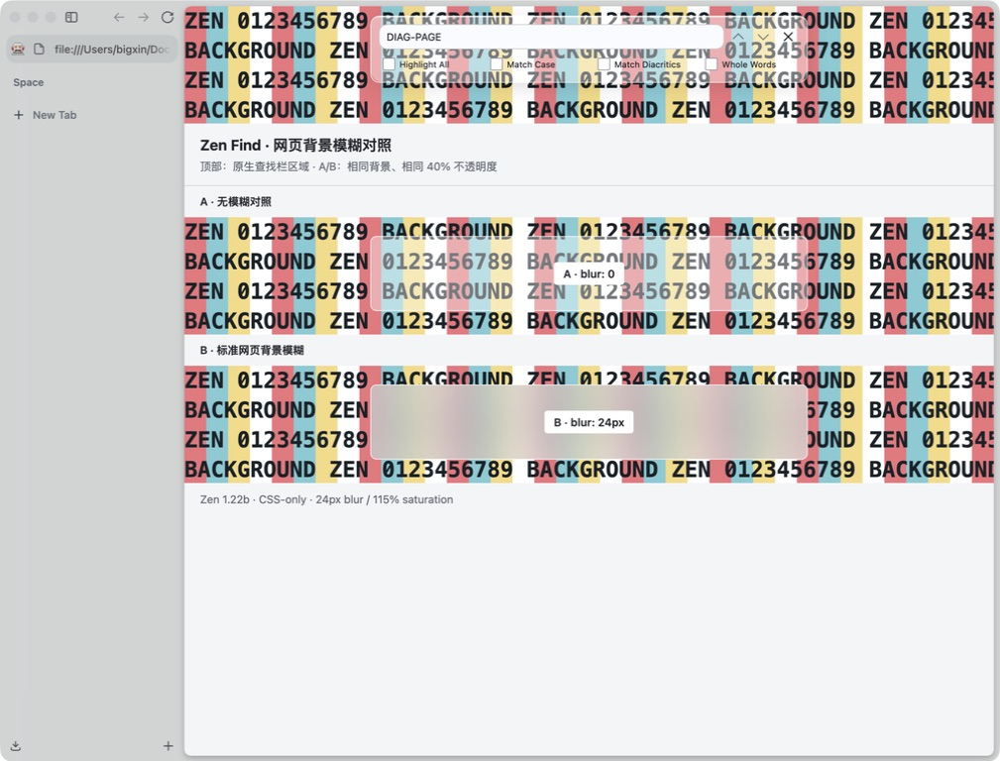
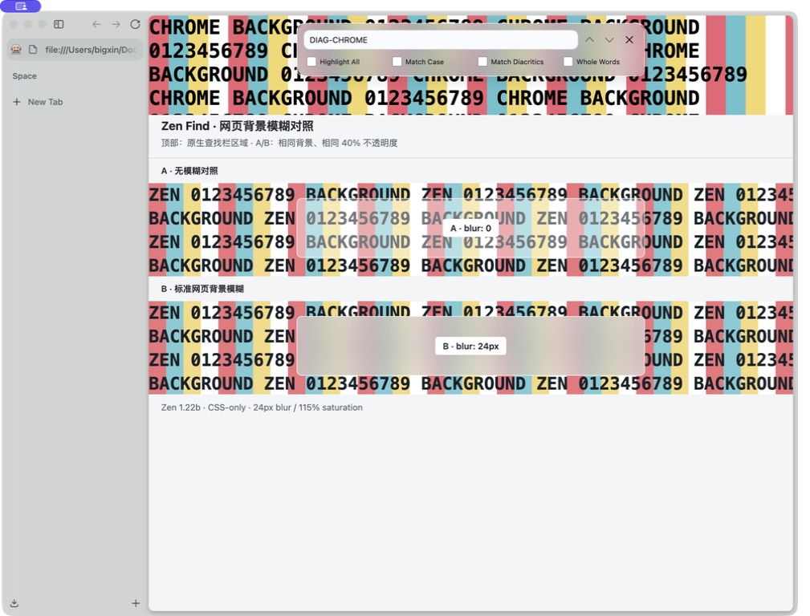

# 网页背景模糊实验

> 历史记录：项目已于 2026-09-08 停止毛玻璃方案，当前发布样式使用不透明纯色背景。本文件仅保留此前实验过程，不属于当前验收目标。

目标：仅模糊查找栏覆盖的网页区域，保持原生输入、计数与按钮清晰。透明度加深、模糊整页和模糊桌面均不算通过。

## 当前结论（2026-09-08）

真实网页背景模糊验收未通过。用户安装后的桌面截图已否定 `45b6399` 的伪元素方案；下面的旧实验记录保留为历史，不代表该方案有效。

本次在 Zen 1.22b / Gecko 155.0.1、BuildID 20260904060728 的独立配置完成桌面对照。为区分同时运行的 Zen 实例，使用本机应用的临时副本，单独设置应用标识并对副本本地签名；浏览器资源和可执行文件来自本机安装版本。截图逐一核对输入框中的 `DIAG-*` 标记，未使用浏览器导出截图判定模糊。独立配置没有安装 Transparent Zen。

| 桌面对照 | 结果 |
| --- | --- |
| 发布 CSS 的伪元素覆盖远程网页条纹 | 透明，文字及条纹边缘清晰 |
| 相同查找栏覆盖 chrome 文档内的临时条纹节点 | 背景真实模糊，原生控件清晰 |
| 滤镜改为直接作用于 findbar，同时移除 transform、container-type、contain | 网页仍不模糊；同文档条纹可模糊 |
| 仅在临时实验中给远程 browser 分别设置 opacity: 0.999、filter: brightness(1) | 网页仍不模糊 |
| 独立配置启动前设 gfx.webrender.compositor=false | wrCompositor 报告 FEATURE_FAILURE_PREF_OFF；上述网页失败、同文档成功的结果不变 |
| 网页 B 区的标准 backdrop-filter | 各组截图均有真实模糊 |

祖先样式检查：无非 none 的 mask-image、clip-path 或祖先 backdrop-filter，无小于 1 的祖先 opacity；根 body 有 contain: paint，部分容器有 overflow: clip。默认 backdrop-filter.enabled=true，force-enabled=false；远程网页的 isRemoteBrowser=true。这些属性记录本身不能证明根因。

证据将问题缩小到远程网页与 chrome 背景采样的差异，排除了“滤镜在 findbar 上完全不能工作”的解释。尚未定位到 Zen/Gecko 的具体代码分支，也不能证明所有纯 CSS 路径均不可能。下一步需对照目标版本的远程网页显示列表及 WebRender 背景读取路径，而不是继续调整模糊半径或底色。关闭原生合成器的实验无效，不建议用户修改此偏好。

## 可复现实验（已移除）

`tools/probe_glass.py` 和 `tests/glass-comparison.html` 已在 2026-10-20 的测试残留清理中删除。
本文件只保留历史记录，不再提供复现命令。

## 本轮环境与结果

Zen 1.22b，独立临时配置，Marionette，headless=False。网页为重复大字号文字，测试面板不透明度设为 0.4，以便辨别背景是否发生模糊。

| 实验 | 浏览器截图结果 |
| --- | --- |
| 当前 findbar，blur(24px) saturate(115%) | 背景文字清晰透出 |
| 移除 transform、container-type、overflow 裁剪 | 未观察到改善 |
| 将滤镜移到 findbar::before 背景层 | 未观察到改善 |
| 临时 HTML 子背景层（仅用于诊断，不加入 Mod） | 未观察到改善 |
| 临时配置中强制开启 backdrop-filter | 未观察到改善 |
| 网页内 HTML 浮层使用标准 backdrop-filter | 浏览器截图同样未显示模糊 |

原生计算样式确认滤镜值不是 none。逐层检查到窗口根节点，未发现祖先 filter、opacity 或 backdrop-filter 导致的明显隔离。nsIGfxInfo 报告 compositor=webrender，hwCompositing、gpuProcess 和 wrCompositor 均为 available。

## 尚不能得出的结论

网页内标准对照同样失败，意味着不能仅根据以上浏览器截图认定查找栏无法跨网页图层采样。桌面截图工具此次选中了另一配置的窗口，未能完成测试窗口实际显示与浏览器截图的对照。因此还不能将截图结果等同于最终 GPU 合成结果，也不能认定纯 CSS 无法实现。

未修改用户的图形偏好；强制开启仅发生在临时配置。实验进程已退出，未将失败方案加入 chrome.css 或安装到 Test。

## 下一验证关口

### 用户桌面截图后的更新

用户提供的同窗截图已确认：网页 B 区真实模糊，查找栏背景仍能辨认文字。因此标准网页滤镜在用户环境中可用。

进一步查看 Gecko 的 layout/painting/nsDisplayList.cpp，nsDisplayBackdropFilters::Paint 仍有 TODO: Implement backdrop filters，而 CreateWebRenderCommands 调用 PushBackdropFilter。这说明普通绘制与 WebRender 的滤镜路径不同，之前的浏览器导出截图不足以否定合成效果。

本轮候选方案：将底色和 backdrop-filter 移至 findbar::before，原生 findbar 背景透明、滤镜为 none；伪元素位于前景控件后方，禁用指针事件。移除外层 overflow 裁剪以减少干扰。布局与伪元素计算样式可以自动验证，是否真正模糊网页仍需桌面截图验收。该方案是实验性修复，尚未确认根因或宣布成功。

先在同一可捕获的桌面测试窗口中确认标准网页浮层确实模糊，然后对照原生 findbar。若标准浮层通过而 findbar 不通过，再检查跨文档合成边界；若两者都失败，先定位渲染设置或采集方式。该对照通过前，不再以换底色、加阴影或提高不透明度宣称毛玻璃修复。
